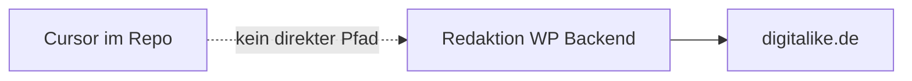
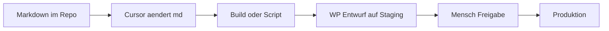

# Entscheidungsnotiz: Cursor, Staging, WordPress

Stand: 30.09.2026. Auftrag: Recherche 1 bis 2 Stunden. Keine Live-Umsetzung in diesem Schritt.

## Ausgangslage

| Thema | Befund |
|-------|--------|
| Live-Stack | WordPress 7.1.2, GeneratePress Child, GenerateBlocks, Contact Form 7, Complianz |
| Inhalte | Seiten und Blöcke in der WP-Datenbank, nicht in Git |
| Cursor | Arbeitet zuverlässig an Dateien in einem Repo (Markdown, TS, Regeln) |
| Staging | Nicht im Repo; typisch Subdomain oder Hosting-Staging des WP-Anbieters |
| Ziel | Neue Landingpages (KI-Schulung, KI-Angebot, Blaupause) plus viele Kombi-URLs später |

## Frage 1: Wie entsteht aus einer Cursor-Anweisung ein Staging-Entwurf?

### Ist-Zustand

GenerateBlocks speichert Layout in `post_content` als Block-Markup. Cursor kann das nicht sinnvoll in der DB pflegen. Copy und Struktur im Repo zu halten ist der kleinste Hebel.

### Soll-Zustand (empfohlen, Option A)

**Schritte im Detail**

1. **Repo**: Eine Datei pro Seite unter `content/pages/` mit YAML-Frontmatter (Slug, Title, Meta, Template).
2. **Cursor**: Anweisung wie „füge Modul n8n zur KI-Schulung hinzu“ ändert nur die Markdown-Datei und ggf. gemeinsame Snippets.
3. **Publish**: Erste Version manuell: Markdown in GenerateBlocks nachbauen oder WP REST API `POST /wp/v2/pages` mit `status: draft` und HTML/Block-Inhalt aus einem einfachen Konverter. Später: kleines Script (Node oder Python) mit Application Password.
4. **Staging**: Gleiche WP-Instanz mit Staging-Plugin oder separate Instanz; Entwurf nie direkt auf Produktion.
5. **Freigabe**: GF oder Marketing prüft URL auf Staging, klickt Veröffentlichen in WP.

**Was Cursor nicht allein kann**

- SSL, DNS, Plugin-Updates, Cookie-Banner-Konfiguration
- Unbeaufsichtigtes Go-Live ohne menschlichen Klick

### Stunden (Schätzung, eine Person mit Cursor)

| Arbeit | Stunden | Anmerkung |
|--------|---------|-----------|
| Repo-Struktur, Schema, erste zwei Seiten als Markdown | 8 bis 12 | In diesem Repo umgesetzt als Inhalt |
| Staging-Zugang klären, ein Entwurf manuell angelegt | 2 bis 4 | Braucht WP-Admin |
| REST-Entwurf-Script (draft only) | 12 bis 20 | Einmalig |
| **Pipeline gesamt (einmalig)** | **24 bis 40** | Danach je Seite 2 bis 4 h Review |
| KI-Schulung in WP nach aktuellem Design | 12 bis 20 | Copy liegt im Repo |
| KI-Angebotsseite inkl. Blaupause-Abschnitt | 12 bis 20 | Copy liegt im Repo |

## Frage 2: WordPress behalten oder ersetzen?

Gemeinsame Messlatte:

| Kriterium | Gewicht |
|-----------|---------|
| Redaktion kann ohne Dev Seiten anpassen | Hoch |
| Cursor kann Vorlagen und Copy versionieren | Hoch |
| Staging = Entwurf, nicht live | Hoch |
| Kombi-Landingpages aus einer Vorlage | Mittel |
| Bestehende URLs, Formulare, Blog, EN | Hoch |
| Modernes Frontend / Automatisierung | Mittel |

### Option A: WordPress bleibt CMS, Repo führt Copy

- **Beschreibung**: GeneratePress/GenerateBlocks bleibt. Neu: Markdown im Repo, Entwurf auf Staging, manuelle oder API-Publish.
- **Pro**: Geringstes Risiko, schnell erste Seiten, CF7 und Complianz unverändert, Team kennt WP.
- **Contra**: Design wirkt weiter „alt“, zwei Welten (Repo + GB-Editor).
- **Stunden bis erste Live-Seite**: 20 bis 32 (Copy im Repo + einmal WP-Einbau Schulung).

### Option B: WordPress Headless, neues Frontend (Next.js o.ä.)

- **Beschreibung**: WP nur noch als Content-API, neues TS/Tailwind-Frontend.
- **Pro**: Modernes UI, Cursor sehr stark auf dem Frontend.
- **Contra**: Build-Pipeline, Hosting, Redirects, GB-Inhalte migrieren, 15 bis 25 PT nur Frontend.
- **Stunden bis erste Live-Seite**: 120 bis 200+ (nicht für den aktuellen 1 bis 2 h Auftrag).

### Option C: WordPress ablösen (Relaunch)

- **Beschreibung**: Neues CMS oder Static Site + Formular-Service.
- **Pro**: Langfristig ein Stack, Automatisierung zentral.
- **Contra**: Migration aller Leistungsseiten, Blog, EN, SEO-Redirects; 30 bis 50 Personentage.
- **Stunden**: Eigenes Projekt mit 8 h Scoping vor Start.

## Frage 3: Kombi-Landingpages und Blaupause

- **Elasticbrains-Muster**: `/n8n-agentur/{stadt}` und `/services/{thema}` mit derselben Vorlage. digitalike hat bereits viele CMS/SEO-Leistungsseiten im Footer.
- **Risiko**: Nur Toolname tauschen = Doorway. Jede URL braucht eigenen Proof (Case, FAQ, Angebot).
- **Reihenfolge Keywords** (Google Ads DE, 21.09.2026): `ki schulung` 2400, `ki workshop` 590, `claude schulung` steigend, `n8n agentur` 90, viele Tool-Kombis 0 bis 10.
- **Blaupause verkaufen**: Erst intern derselbe Workflow (Anweisung, Repo, Staging-Entwurf, Freigabe), dann als Setup-Paket. Keine Cursor-Lizenzen verkaufen.

## Kurzfassung für die Geschäftsführung

1. Cursor automatisiert **Inhalt und Struktur im Repo**, nicht das Live-WP-Backend allein.
2. Staging + Entwurf + Freigabe ist Pflicht.
3. **Empfehlung**: Option A jetzt; Option C nur als separates Relaunch-Projekt nach Gate.
4. Erste Seiten: KI-Schulung, dann KI-Automatisierung inkl. Blaupause-Abschnitt.
